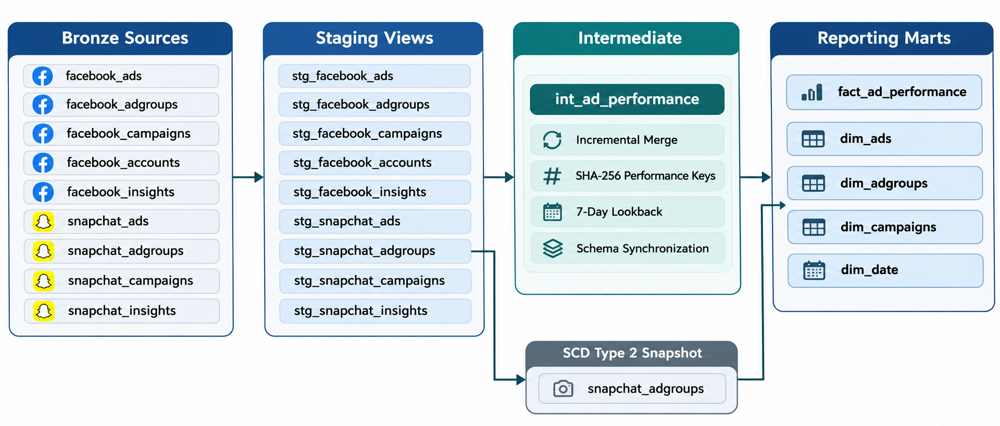
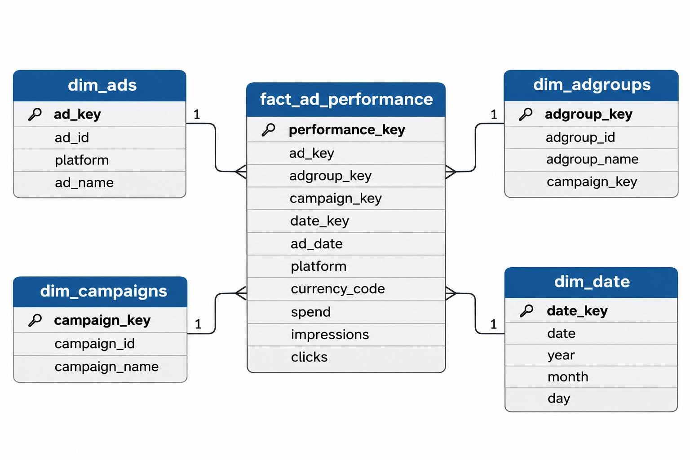

cat > README.md <<'EOF'
# Marketing Analytics dbt Pipeline

An end-to-end marketing analytics pipeline built with dbt Core and Databricks, combining Facebook and Snapchat advertising data into a Kimball star schema.

## Architecture


The diagram below illustrates the data flow from Bronze sources through staging and incremental transformation into reporting marts.



## Star Schema — Entity Relationship Diagram

The ERD shows how the advertising performance fact table connects to the ads, ad groups, campaigns, and date dimensions.



Bronze sources → Staging views → Incremental intermediate model → Reporting marts

- **Bronze:** 9 source tables with freshness monitoring.
- **Staging:** 9 views standardizing identifiers, types, and metrics.
- **Intermediate:** Incremental `int_ad_performance` model using merge, SHA-256 performance keys, a 7-day lookback, and schema synchronization.
- **Marts:** `fact_ad_performance`, `dim_ads`, `dim_adgroups`, `dim_campaigns`, and `dim_date`.
- **SCD Type 2:** Snapchat ad-group snapshot tracking name and campaign assignment changes.

## Data Validation

- 95,109 performance records with unique performance keys.
- Facebook: 92,300 records.
- Snapchat: 2,809 records.
- All fact records matched their dimensions.
- Deduplicated Snapchat ad groups to 264 unique current records.
- Preserved EUR and USD separately; no currency conversion is applied.
- Enforced model contracts on the fact and ads dimension.
- Generic tests for uniqueness, nulls, accepted values, and relationships.
- Two passing singular SQL tests for nonnegative metrics and fact/intermediate reconciliation.

## Marketing Metrics

- CTR (%) = clicks / impressions × 100
- CPC = spend / clicks
- CPM = spend / impressions × 1,000

Ratios must be recalculated from aggregated totals when reporting across records. Monetary totals must be grouped by currency.

## SCD Type 2

The initial Snapchat snapshot contains 264 current versions and no historical versions. Future changes to tracked attributes can create historical records. The snapshot does not reconstruct history from before its first run.

## Run the Project

Install dependencies using the project's uv environment and configure a Databricks dbt profile.

```bash
uv run dbt debug
uv run dbt source freshness
uv run dbt build
uv run dbt snapshot